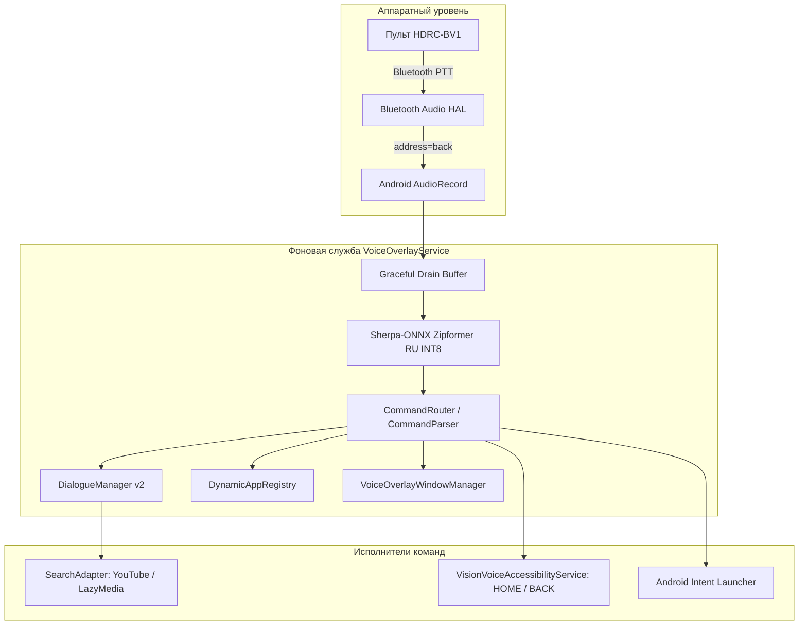

# VisionVoiceOffline

Полностью автономный голосовой ассистент для смарт-телевизоров **Huawei Vision S** (серия KANT-359). 
Приложение работает локально на процессоре телевизора без обращения к серверам Google, Яндекс или любым другим облачным сервисам.

[English description (README_EN.md)](README_EN.md)

---

## Ключевые возможности

- 🔒 **100% автономное распознавание речи:** локальный инференс модели Zipformer RU INT8 через библиотеку Sherpa-ONNX.
- 🎙️ **Аппаратный Push-to-Talk (PTT):** захват звука с Bluetooth-пульта **Huawei HDRC-BV1** активен только при удержании физической кнопки микрофона.
- 📺 **Глобальный голосовой оверлей:** полупрозрачный немодальный интерфейс поверх других приложений и видео, не перехватывающий кнопки навигации пульта.
- 🔍 **Универсальный голосовой поиск (M5):**
  - Прямой поиск: «Найди на Ютубе осень в Норвегии 4К».
  - Поиск в активном приложении с подтверждением: «Искать «Доктор Кто» в YouTube?».
  - Контекстный диалог при неизвестном источнике: «Где будем искать?» $\to$ «В Лэйзи Медиа».
  - Память последнего запроса (120 секунд): повтор («А теперь в Лэйзи Медиа») и уточнения («А теперь второй сезон», «Только на русском», «С субтитрами»).
- 📱 **Каталог установленных приложений:** динамическое обнаружение установленных ТВ-приложений с поддержкой добавления пользовательских голосовых алиасов.
- ⚙️ **Системная навигация без Root:** безопасное выполнение команд «Домой», «Назад» и «Недавние» через службу специальных возможностей.

---

## Архитектура решения

---

## Поддерживаемые голосовые команды

| Категория | Примеры команд |
|---|---|
| **Громкость** | «Громче», «Тише», «Громкость двадцать», «Звук на ноль», «Без звука» |
| **Медиа** | «Пауза», «Продолжить», «Стоп», «Следующий трек», «Предыдущий» |
| **Навигация** | «Домой», «Назад», «Недавние приложения» |
| **Приложения** | «Открой Ютуб», «Запусти Лэйзи Медиа», «Закрой БайБай ДИПИАЙ», «Сверни» |
| **Поиск** | «Найди на Ютубе осень в Норвегии 4К», «Найди сериал Доктор Хаус», «А теперь второй сезон» |

---

## Документация

- [Руководство по установке (INSTALL_RU.md)](docs/INSTALL_RU.md)
- [Таблица совместимости и проверенных приложений (TESTED_APPS.md)](docs/TESTED_APPS.md)
- [Разработка поисковых адаптеров (SEARCH_ADAPTER_DEVELOPMENT.md)](docs/SEARCH_ADAPTER_DEVELOPMENT.md)
- [Настройка сетевого подключения ADB (ADB_SETUP_RU.md)](docs/ADB_SETUP_RU.md)
- [Решение типичных проблем (TROUBLESHOOTING_RU.md)](docs/TROUBLESHOOTING_RU.md)
- [Управление сертификатами и подписью (RELEASE_SIGNING_GUIDE.md)](docs/RELEASE_SIGNING_GUIDE.md)
- [Черновик публикации для 4PDA (4PDA_POST_RU.md)](docs/4PDA_POST_RU.md)
- [Сторонние компоненты и лицензии (THIRD_PARTY_NOTICES.md)](THIRD_PARTY_NOTICES.md)

---

## Требуемые разрешения

- `RECORD_AUDIO` — захват звука с микрофона пульта при удержании PTT.
- `FOREGROUND_SERVICE` — обеспечение непрерывной работы фоновой службы.
- `SYSTEM_ALERT_WINDOW` — отображение полупрозрачного оверлея поверх других окон.
- `RECEIVE_BOOT_COMPLETED` — автозапуск после включения телевизора.
- `BIND_ACCESSIBILITY_SERVICE` — выполнение системных действий HOME и BACK.

---

## Лицензия

Исходный код проекта **VisionVoiceOffline** распространяется под лицензией **Apache License 2.0**. См. файл [LICENSE](LICENSE).

Сведения о лицензиях сторонних библиотек (sherpa-onnx, ONNX Runtime, AndroidX, Zipformer RU) приведены в файле [THIRD_PARTY_NOTICES.md](THIRD_PARTY_NOTICES.md).

